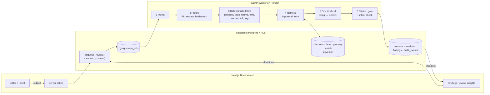

# Errata

**Pre-publication checks with cited rules.** Every draft (text, doc, image, PDF) is checked against an organisation's approved rule cards, facts and assets, and every flag cites the rule or fact ID it was checked against. Humans approve; Errata never publishes.

Built for the Inkloom AI brand-governance problem statement (Round 2, "Build") by Maanit Gupta and Jagpreet Singh (SRMIST).

> Errata was called BrandLens until 2026-10-28. The code lives at https://github.com/maanit-gupta/Errata; package, service and project names still use `brandlens` (see [Names that still say brandlens](#names-that-still-say-brandlens)).

- **Live app:** https://brandlens-app.vercel.app. On the login page, pick a role under "Try a demo role" (no password needed). All data is the fictional PayWise brand.
- **Demo video:** a 60-second silent walkthrough with captions and a transcript, under "How it works" on the landing page (`apps/web/public/demo/`).
- **Demo script:** [`docs/DEMO.md`](docs/DEMO.md) (3–4 minutes, storyboard F01–F06).
- **Build spec:** [`docs/SPEC.md`](docs/SPEC.md) · **Design system:** [`docs/DESIGN.md`](docs/DESIGN.md) · **Security review:** [`docs/SECURITY.md`](docs/SECURITY.md) · **Build log:** [`PROGRESS.md`](PROGRESS.md)

## The problem, and what Errata does

Marketing teams in regulated categories (PayWise is a fictional Indian mutual-fund app) publish under brand guides and compliance rules that live in PDFs nobody re-reads. Mistakes are cheap to make and expensive to ship: a "guaranteed returns" claim, last campaign's event date, a misspelt brand name, an inaccessible colour pair.

Errata turns the guide into **rule cards** and a **Fact Vault**, checks each draft before it goes out, and **cites** the rule or fact behind every flag. A creator states the draft's intent (goal, audience, CTA, channel, campaign) and gets findings with suggested rewrites that keep that intent. Blockers route to the right reviewer (Legal or Accessibility), every decision needs a reason, and nothing is published automatically. Over time, the **Guideline Clarity Score** shows which rules reviewers keep overriding, so the brand team can fix the rule rather than blame the writer.

## How it works



Key decisions:

- **Deterministic first.** Anything checkable without a model (brand terms, fees, dates, venues, campaign bleed, contrast, colour ΔE, logo placement) never goes to the LLM. The LLM judges only tone and claims nuance, in **one call per draft**.
- **The LLM is untrusted.** The draft is redacted and delimited data; output is schema-bound (Pydantic); quotes are matched and offsets computed locally. A finding survives the **citation gate** only if it cites a rule or fact retrieved for this run, in the matching dimension, with a quote that is really in the draft.
- **Humans decide.** Every state change goes through one SQL function (`transition_content`) that enforces the state machine and permissions and writes the audit log. Blockers and low-confidence findings can't be one-click accepted; overrides need a reason.
- **Measured, then gated.** A 60-row golden set runs in CI. Any dimension under 85% precision is demoted to suggestion-only.

## Results

**Golden set** (`make eval`, [`apps/worker/eval/report.md`](apps/worker/eval/report.md); 60 drafts: 49 text, 10 images, 1 PDF, 13 clean; LLM responses replayed from a committed cache):

| Metric | Result | Target |
|---|---|---|
| Blocker recall | **1.00** (32 seeded blockers) | ≥ 0.80 |
| Uncited findings shown | **0** | 0 |
| Precision by dimension | claims 1.00 · facts 0.90 · terms 1.00 · tone 0.90 · visual 1.00 · access 1.00 | ≥ 0.85 each |
| Overall precision / recall | 0.96 / 0.99 | |
| Clean drafts with any finding | 0 of 13 | |
| Rewrite intent check (`INTENT_COSINE` 0.74) | keeps 15/16 good rewrites, 0/24 bad | |
| Latency (30 text drafts) | P50 3.0 s · P95 15.2 s (LLM time as recorded) | P95 ≤ 15 s |

A deliberately broken prompt drops tone precision to 0.43, and the gate fails the build ([`PROGRESS.md`](PROGRESS.md), P14).

**Images** ([`vision_report.md`](apps/worker/eval/vision_report.md)): logo found in 9/9 creatives with 0 false positives; WCAG contrast within ±0.1 of WebAIM on 40/40 PNG colour pairs; 1.1 s per creative. **PDF decks** ([`pdf_report.md`](apps/worker/eval/pdf_report.md)): 9/9 seeded issues found on the right page, including two hidden-text injections; a 40-page deck stays under 512 MB.

**Usability:** A/B benchmark (manual guideline check vs Errata) and SUS templates are in [`docs/usability/`](docs/usability/). _Results pending: sessions are run by Jagpreet._

## Quick start

Requires Node 22+, pnpm, [uv](https://docs.astral.sh/uv/), the Supabase CLI and Docker.

```bash
git clone https://github.com/maanit-gupta/Errata.git
cd Errata
make setup   # pnpm install + uv sync
make dev     # web on :3000, worker on :8000 (GET /healthz)
make check   # lint + types + tests
```

Copy `apps/web/.env.example` → `apps/web/.env.local` and `apps/worker/.env.example` → `apps/worker/.env`, then fill them in. Both services refuse to start if a variable is missing and name it.

## Running locally

```bash
make setup && make models   # deps + the bge-small embedding model
make db-start && make db-reset
make dev-local              # web :3000 + worker :8000 against the LOCAL Supabase stack
```

Low on disk? `make db-start lite=1` skips Studio, mail, analytics, the image proxy and edge functions. If the Supabase CLI isn't installed, `make` falls back to `npx supabase@2`. On a fresh clone without `apps/web/.env.local` or `apps/worker/.env`, `make dev-local` fills in local-only defaults (`scripts/local-supabase-env.sh`). The LLM keys are placeholders, so reviews run in degraded mode (deterministic findings only) until you add real keys.

`make dev` runs against whatever `apps/*/.env*` point at (the cloud project). E2E:
`cd apps/web && E2E_WORKER=1 pnpm exec playwright test` (needs `make dev-local`); add `E2E_LLM=1` for the live guide-upload test.

## Deploying

**Live:** web https://brandlens-app.vercel.app (Vercel project `brandlens`), worker https://brandlens-worker.onrender.com (Render service `brandlens-worker`). Both deploy automatically on every push to `main`. The steps below are for recreating them from scratch.

Supabase project: `BrandLens`, **ap-southeast-1 (Singapore)**. Migrations: `supabase db push --db-url <session-pooler-URI>`; demo data: `make seed-demo url=<SUPABASE_URL>` (then any running worker embeds the vault).

**Worker → Render** (free tier, Docker):
1. Render Dashboard → **New → Blueprint** → select this repo. `render.yaml` defines `brandlens-worker` (Docker, `apps/worker`, Singapore, health check `/healthz`).
2. Fill the `sync: false` secrets when prompted: `SUPABASE_URL`, `SUPABASE_SECRET_KEY`, `DATABASE_URL` (**session pooler**, `aws-0-ap-southeast-1.pooler.supabase.com:5432`), `GROQ_API_KEY`, `GEMINI_API_KEY`, `LANGFUSE_HOST`, `LANGFUSE_PUBLIC_KEY`, `LANGFUSE_SECRET_KEY`, and optionally `DISCORD_WEBHOOK_URL` + `SITE_URL` (the Vercel URL).
3. Free web services sleep after ~15 min idle, which pauses the queue consumer. Set the web env `WORKER_URL` (each submit pings `/healthz`) and the GitHub repo variable `WORKER_URL` (the `keepalive.yml` workflow pings every 10 min). If the 512 MB instance runs out of memory, switch the plan to Starter.

**Web → Vercel:** import the repo, **Root Directory `apps/web`** (pnpm detected). Env vars: `NEXT_PUBLIC_SUPABASE_URL`, `NEXT_PUBLIC_SUPABASE_PUBLISHABLE_KEY`, `SUPABASE_SECRET_KEY`, `NEXT_PUBLIC_SITE_URL` (the Vercel URL), `NEXT_PUBLIC_DEMO_MODE=true`, `DISCORD_WEBHOOK_URL`, `WORKER_URL`, optional `RESEND_API_KEY`/`EMAIL_FROM`. Then in Supabase → Authentication → URL Configuration set **Site URL** and add the Vercel URL to **Redirect URLs**.

**Verify:** `cd apps/web && E2E_BASE_URL=https://<your-app>.vercel.app pnpm exec playwright test e2e/core-loop.spec.ts`, and check the Render logs for `review done`.

## Local database and demo accounts

```bash
make db-start   # local Supabase (Docker). API on :55321, Postgres on :55322, Studio on :55323
make db-reset   # apply supabase/migrations/* from zero, then supabase/seed.sql
make test-db    # pgTAP: RLS, state machine, queue, retrieval
make types      # regenerate apps/web/types/database.ts
```

Local ports are shifted to the 553xx range so Errata can run next to another local Supabase project.

The seed creates the fictional **PayWise** org (SPEC §16). Every demo account uses the password **`PayWise-demo-2026`** (demo only; never reuse it):

| Email | Role |
|---|---|
| `admin@paywise.demo` | brand admin |
| `creator@paywise.demo` | creator |
| `agency@paywise.demo` | agency creator |
| `manager@paywise.demo` | manager |
| `legal@paywise.demo` | specialist (legal) |
| `a11y@paywise.demo` | specialist (accessibility) |

To load the same data into the cloud project: `make seed-demo url=<SUPABASE_URL>`. The URL must match `apps/worker/.env`. Re-running is safe; existing rows are never overwritten. It also uploads the PayWise logo files that the image checks match against; locally, run `make seed-assets-local` after every `make db-reset`.

Image checks need the Tesseract binary (`brew install tesseract`, or `apt-get install tesseract-ocr`; the worker Docker image includes it). `make eval-vision` re-measures them on the 10 labelled creatives in `fixtures/paywise/creatives/` and writes `apps/worker/eval/vision_report.md`.

## Security and reliability

The full checklist with evidence is in [`docs/SECURITY.md`](docs/SECURITY.md): RLS on every table (pgTAP), no secrets in client bundles, 15-minute signed URLs, private buckets with size limits, prompt-injection tests, a 10-per-minute submit limit enforced in SQL, 4 MB upload limits, and CSP plus security headers.

**Degraded mode.** If both LLM providers fail (bad key, outage, or free-tier 429s after retries), a review still finishes with every deterministic finding (glossary, facts, campaign bleed, claims lexicon, tone heuristics, readability, contrast, ΔE, logo). The run is stored with `degraded = true`, and the draft page says only the deterministic checks ran. With invalid keys on the golden hero, claims and tone rows, blocker recall stayed at 1.00. A provider that stays rate-limited is skipped for 60 s, so queued jobs don't each wait through the same backoff.

**Worker restarts.** Jobs are pgmq messages with a 120 s visibility timeout. If the worker dies mid-job, the message becomes visible again and the next read reruns it. Runs are idempotent: a finished run is skipped, and a rerun replaces its own findings. After 3 reads the message is archived and the run marked failed. `scripts/redelivery_test.py` shows this: an abandoned run was picked up after the timeout and finished.

**Load test** (`scripts/load_test.py`, 2026-10-27, local Supabase plus one local worker with 3 review consumers; 50 concurrent submissions of a 524-word draft with one blocker):

| Run | Finished | Failed | With LLM | Wall | Throughput | P50 | P95 |
|---|---|---|---|---|---|---|---|
| Before the router cool-down (35-draft burst; snapshot when 32 had finished, then lost to a local DB reset) | 32 | 0 | 4 | ≥ 14 min | ≤ 2.3/min | mean 7.0 min | max 14.1 min |
| After the cool-down (50 drafts) | 50 | 0 | 0 | 58 s | 51.6/min | 49.5 s | 57.5 s |

The bottleneck is the free LLM tiers, not the pipeline. Groq and Gemini rate limits were already spent by the day's eval runs, so in the second run every review came back degraded (deterministic findings only, flagged in the UI) and none failed. Without rate limits, an LLM review takes P50 2.9 s and P95 15.2 s (recorded provider latency, `apps/worker/eval/report.md`). A paid tier or a per-org LLM budget is the fix for sustained bursts. We didn't load-test the deployed stack, so the live demo's quota stays intact; pass the cloud session-pooler `DATABASE_URL` to the same script to do it.


## Changes since Round 1

Mirrors the "Deliberate deviations" table in [`CLAUDE.md`](CLAUDE.md).

| Area | Round 1 plan said | We built | Why |
|---|---|---|---|
| Auth | Google sign-in | Supabase email/password, plus a demo role switcher when `NEXT_PUBLIC_DEMO_MODE=true` | No OAuth setup; judges get one-click roles |
| Visual design | Light off-white palette with a serif display face | A flat, outlined, light-first system ([`docs/DESIGN.md`](docs/DESIGN.md)): white surfaces, 2px ink outlines, yellow fills for primary actions, grey and pink section bands, DM Sans with DM Mono for IDs, original illustrations, and a dark theme. Also a public landing page with a demo video, a ⌘K palette and keyboard shortcuts. Every colour pair is checked for WCAG AA in a unit test, and the app is axe-clean (WCAG 2.2 AA) on every route in both themes | Team design decision (it replaced the earlier dark "Terminal Noir" look on 2026-10-28); rule and fact IDs stay first-class, and severity never relies on colour alone |
| Name | BrandLens | **Errata** (user-facing only; repo `maanit-gupta/Errata`) | Team decision; internal identifiers keep `brandlens` so deploys and data don't break |
| LLM | Claude or Gemini | **Groq** primary, **Gemini** fallback, both free tiers, chosen by `LLM_PROVIDER` | Free APIs; the provider switch still avoids lock-in |
| Notifications | Slack + email | Discord webhook (email via Resend is optional and off) | Team uses Discord |
| Tracing | Self-hosted Langfuse | Langfuse Cloud | Faster to set up; traces contain only fictional demo data |
| Web framework | Next.js 15 | Next.js 16 (App Router) | Current stable |
| Confidence | Two-sample agreement on every LLM finding | Second sample only for blocker-severity LLM findings | Resolves the plan's "one LLM call per draft" vs "two samples" contradiction |
| Embeddings | bge-small via sentence-transformers | Same model via fastembed (ONNX) | No torch; smaller worker image |
| Data training | "No training on our data" | True for Groq and paid tiers; the Gemini free tier may use prompts, so the demo uses fictional data only, and the Services and AI-use page says so | Honesty |
| Hosting | Worker on Railway or Fly; Supabase in Mumbai | Worker on **Render** (free tier, Docker); Supabase in **Singapore** | Free tier available to us at build time |

## AI assistance

Per General Rules 6–7, we disclose that this codebase is written with AI assistance. Claude Code (Anthropic) is used as a pair programmer for scaffolding, implementation and tests, working phase by phase from [`docs/PHASES.md`](docs/PHASES.md). Every change is reviewed and committed by a team member. The product's own runtime LLM use (Groq and Gemini) is documented separately on the in-app Services & AI-use page.

| Phase | AI-assisted work |
|---|---|
| P00 | Repo bootstrap: Makefile, web and worker scaffolds, env validation, CI |
| P01 | Database migrations, RLS policies, workflow SQL functions, pgTAP tests, demo seed scripts |
| P02 | Web shell: design tokens, shared components, Supabase auth, demo role switcher, permissions matrix, a11y e2e tests |
| P03 | Worker core: pgmq consumer, LLM router with fallback and validation retry, response cache, embeddings, Langfuse tracing |
| P04 | PayWise demo kit (guide, CSVs, logos), guide parsing and LLM rule extraction, vault embeddings, CSV import route |
| P05 | Vault admin UI (rule cards, facts, glossary, campaigns, assets, guides), approve/revise SQL functions, live updates |
| P06 | Review pipeline stages 1–4: ingest, PII/secret redaction, deterministic filters (terms, facts and campaign bleed, claims, tone, access), retrieval, routing |
| P07 | LLM review pass, citation gate, confidence scoring, intent verification of rewrites, degraded mode, tracing |
| P08 | Draft editor (TipTap) with live finding highlights, intent capture, findings panel with accept/edit/dismiss/route, offsets util and tests |
| P09 | Review queue and reviewer view, decisions via transition_content, version diff, comments, audit trail, Discord/email notifications |
| P10 | Worker Dockerfile, Render Blueprint, cloud migrations and seed, core-loop e2e (local and cloud), keep-alive |
| P11 | Image checks: OCR (Tesseract, optional Paddle), logo detection (ORB + template), WCAG contrast, palette ΔE, warmth pre-filter, vision LLM pass and gate, labelled test creatives and vision eval, image viewer with bbox overlays |
| P12 | PDF decks: page spans and word boxes, hidden-text detection, page renders, per-chunk LLM pass, embedded-image checks, page overlays and page navigation, 40-page benchmark |
| P13 | Guideline Clarity Score SQL, insights summary, UNCLEAR-rule example generation and approval flow, activity simulator, insights dashboard, AI-use models list |
| P14 | Golden set (60 rows, 40 rewrite pairs), in-process eval runner with committed LLM cache, precision gate, `INTENT_COSINE` calibration, latency benchmark, eval CI workflow, precision fixes from the reports |
| P15 | Security review and `docs/SECURITY.md`, submit rate limit, CSP/headers, upload and storage limits, prompt-injection fence and tests, router cool-down, consumer concurrency, load and restart test scripts, a11y sweep and keyboard test |
| P16 | README (pitch, architecture, results, licences, contributions), demo script, demo reset script, usability templates |
| UI redesign (R0–R6, R7–R10 first pass) | Design study, the flat outlined design system and tokens, the WCAG contrast test and colour lint rules, restyled components, app shell, landing, sign-in and feature panels, original SVG illustrations and the wordmark |
| Rename and repo move | User-facing rename to Errata, the list of identifiers that keep `brandlens`, and links pointing at the `maanit-gupta/Errata` repo |
| Demo video | Capture script for real app screens, a HyperFrames composition (storyboard in `apps/web/video-src/brag-plan.md`), renders, captions, transcript and the landing-page embed |
| Local stack | `make db-start lite=1`, the Supabase CLI fallback and local env defaults so a fresh clone runs |

## Models, services, data and libraries

**Models**

| Model | Use | Licence / terms |
|---|---|---|
| `openai/gpt-oss-120b` via Groq | Review pass (text), rule-card extraction, example generation | Apache-2.0 weights; Groq API terms |
| `qwen/qwen3.8-27b` via Groq | Vision review pass (images) | See the model card on Groq; Groq API terms |
| Gemini Flash (`gemini-3.6-flash`) via Google AI Studio | Fallback for both passes | Google Gemini API terms (free tier may use prompts; demo data is fictional) |
| `BAAI/bge-small-en-v1.5` via fastembed | Embeddings for retrieval and the intent check | MIT |
| Tesseract OCR (PaddleOCR optional) | Text in images | Apache-2.0 |

Model IDs come from env (`GROQ_MODEL_*`, `GEMINI_MODEL_*`). The table lists the ones recorded in the latest eval report.

**Services:** Supabase (Postgres, Auth, Storage, Realtime, pgvector, pgmq), Vercel (web), Render (worker), Groq and Google AI Studio (LLM APIs), Langfuse Cloud (tracing), Discord webhooks (notifications), GitHub Actions (CI). All are on free tiers.

**Data:** no external datasets. The PayWise brand kit (guide, facts, glossary, logos, creatives, deck) and the golden set are fictional and written by the team (`fixtures/paywise/`, `apps/worker/eval/golden/`).

**Templates and assets:** shadcn/ui components (MIT, copied into `apps/web/components/ui`); fonts DM Sans and DM Mono (SIL OFL 1.1, via `next/font`); lucide icons (ISC). Illustrations and the wordmark are original inline SVGs drawn for this project; no third-party artwork or templates are used.

**Demo video tooling** (build time only, not shipped in the app bundle): HyperFrames (Apache-2.0, run via `npx`) and GSAP (Standard "no charge" licence, vendored in `apps/web/video-src/composition/vendor/`). Every screen in the video is a capture of the running app with the fictional PayWise data.

**Libraries**

| Package | Licence |
|---|---|
| PyMuPDF | AGPL-3.0 |
| psycopg (binary, pool) | LGPL-3.0 |
| fastapi, pydantic, pydantic-settings, supabase-py, langfuse, python-docx, textstat | MIT |
| uvicorn, numpy, httpx, pyahocorasick, scikit-image, scipy, diff (JS) | BSD-3-Clause |
| tenacity, fastembed, groq, google-genai, trafilatura, opencv-python-headless, pytesseract, paddleocr (optional) | Apache-2.0 |
| next, react, react-dom, zod, tailwindcss, @base-ui/react, cn, shadcn, tw-animate-css, @supabase/ssr, @supabase/supabase-js, server-only, sonner, @tiptap/*, recharts, motion, cmdk | MIT |
| lucide-react | ISC |
| class-variance-authority | Apache-2.0 |
| Dev: pytest, ruff, mypy, eslint, prettier, vitest (MIT); pytest-asyncio, typescript, @playwright/test (Apache-2.0); @axe-core/playwright (MPL-2.0) | as listed |

The source of truth is the dependency table in [`PROGRESS.md`](PROGRESS.md) (Decisions log), updated whenever a dependency is added.

## Limitations and roadmap

- **Free-tier LLMs are the throughput limit.** Under a burst, Groq and Gemini rate limits push reviews into degraded mode (deterministic findings only, clearly flagged). Next: a paid tier or a per-org LLM budget, and a queue-aware "LLM pass pending" state that fills in later.
- **PDFs:** vector-drawn logos aren't detected; scanned PDFs (no text layer) are rejected; picture warmth inside decks is counted, not judged.
- **Images:** contrast on JPEG uploads is an estimate (chroma subsampling); PNG is exact.
- **Worker memory:** a 40-page deck peaks at 484 MB on the 512 MB instance. Heavy jobs are serialised, but a 1 GB instance is safer for heavy PDF use.
- **CSP** keeps `'unsafe-inline'` for scripts (see `docs/SECURITY.md`).
- **Roadmap:** Google sign-in, Slack notifications, a CMS publishing hand-off (still human-approved), multilingual rule cards, and per-channel rule scoping.

## Team and contributions

| Member | Role | Contribution |
|---|---|---|
| **Maanit Gupta** | AI and backend lead | Worker pipeline (ingest, redaction, deterministic filters, retrieval, LLM pass, citation gate, intent check), vision and PDF checks, schema, RLS and workflow SQL, eval golden set and CI gate, deployment, security hardening. Ran the Claude Code sessions for every phase, including the web UI phases. As of 2026-10-27, every commit in the git history is authored from Maanit's account (`maanit-gupta`). |
| **Jagpreet Singh** | Product, frontend and UX lead | Co-author of the Round 1 plan and storyboard. Owns product and UX direction, usability testing (`docs/usability/`) and the live demo. Led the 2026-10-28 UI redesign (design study, the flat outlined design system, tokens and contrast test, restyled components, shell, landing and sign-in, original illustrations), the rename to Errata, the "How it works" demo video, and the local-stack fixes for fresh clones. Those commits are authored from Jagpreet's account and were developed on the `UI/UX_jagpreet` branch with Claude Code. |

## Names that still say brandlens

These keep the old name on purpose. Renaming them would break deploys, sessions or data:

- **Hosting:** `brandlens-app.vercel.app`, `brandlens-worker.onrender.com`, the Vercel project `brandlens`, the Render service `brandlens-worker`, and the Supabase project `BrandLens`.
- **Code:** the npm package `@brandlens/web`, the Python package `brandlens_worker`, the `bl_*` cookies, and env var names.
- **Data and tooling:** database objects (`supabase_db_brandlens`, `brandlens.workflow_write`), Langfuse names, and the CI image tag `brandlens-worker`.

## Licence

[AGPL-3.0](LICENSE), because PyMuPDF is AGPL.
