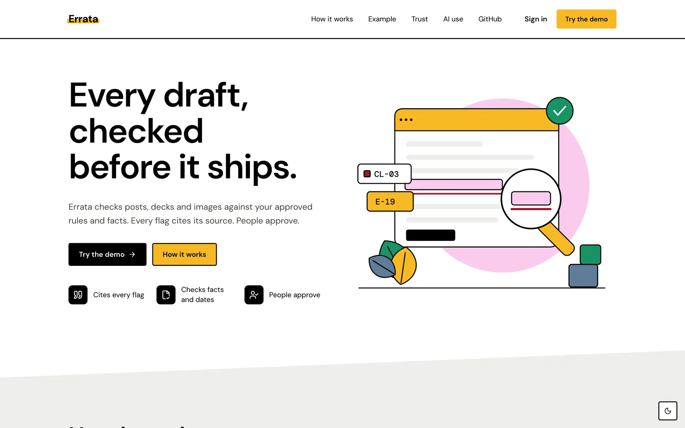
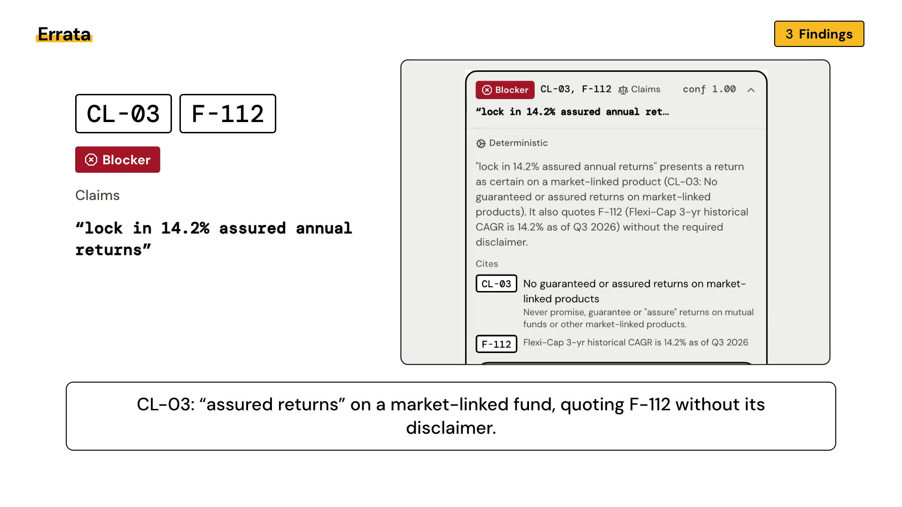
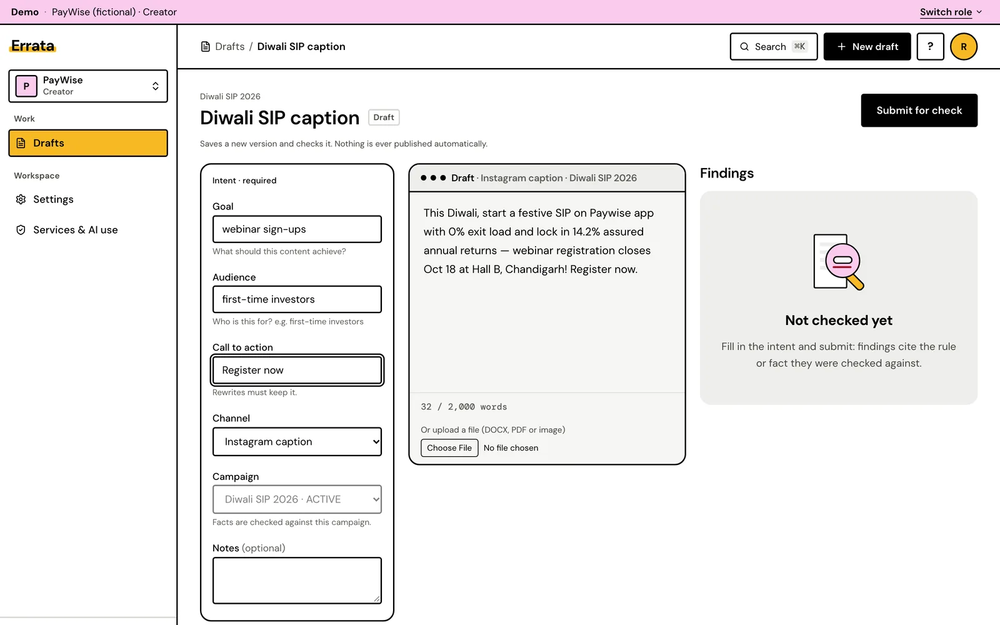
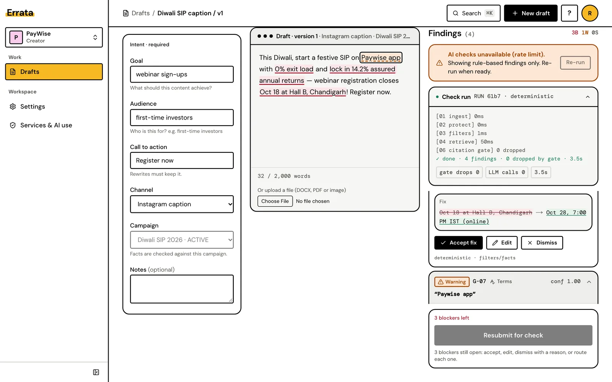
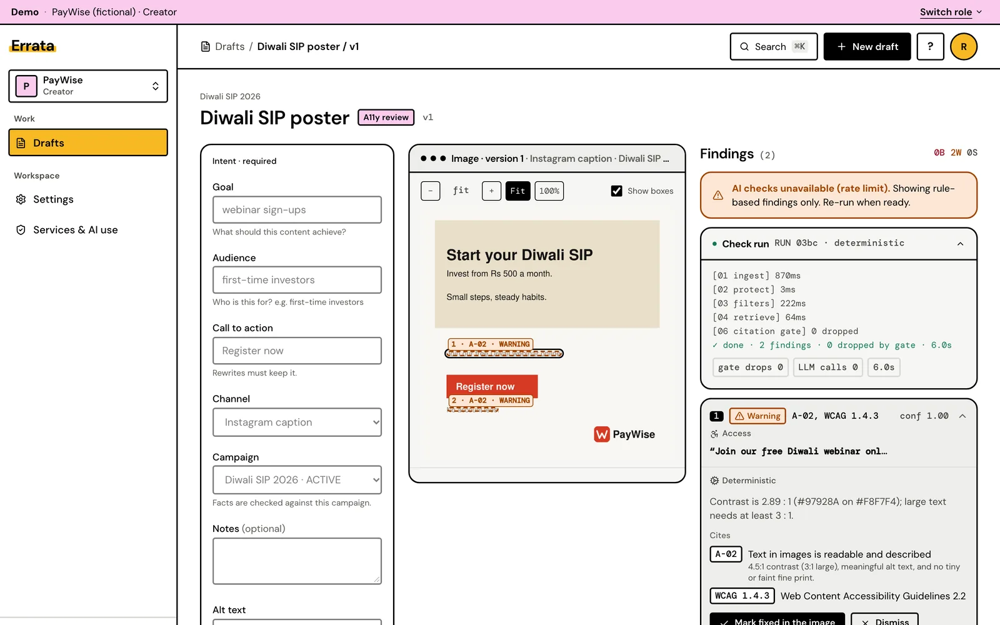
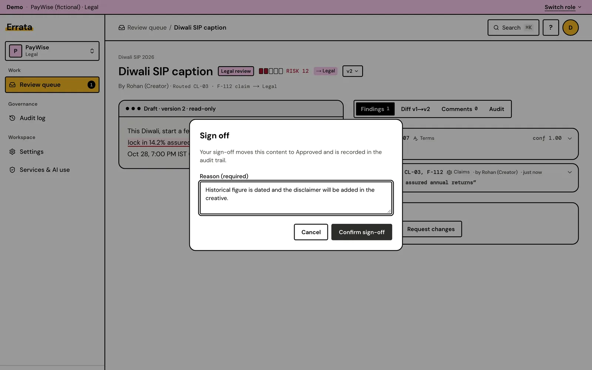
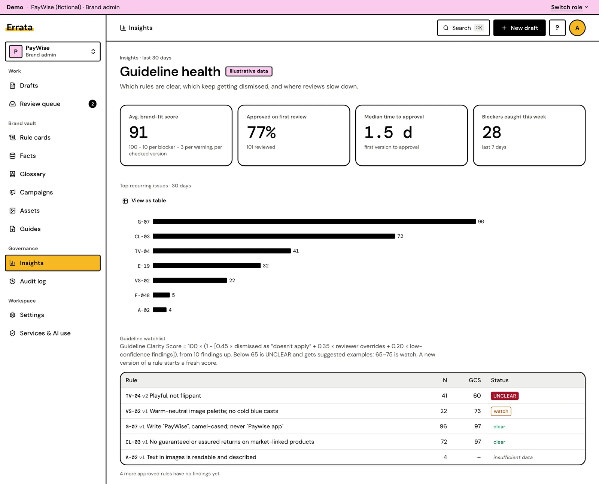
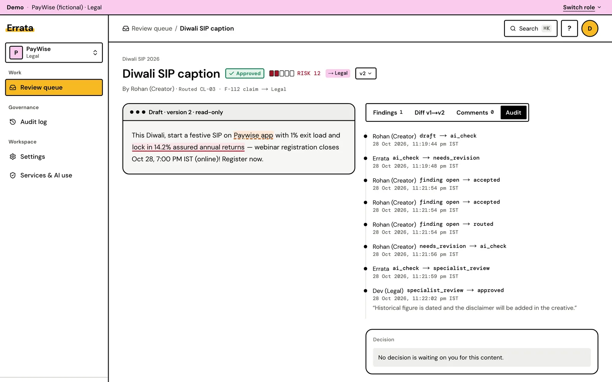
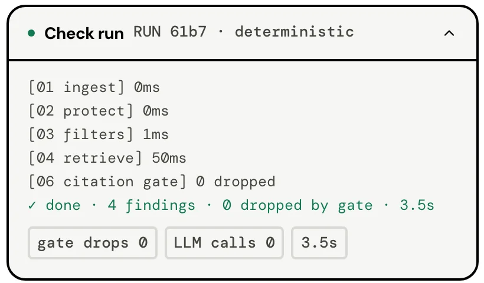
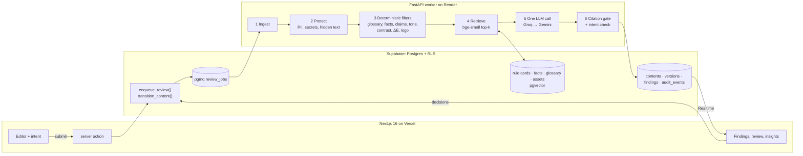

# Errata

**Pre-publication checks with cited rules.**

Errata checks every marketing draft against your approved brand rules and facts before it ships, cites the rule behind every flag, and leaves the decision to people.

[](https://github.com/maanit-gupta/Errata/actions/workflows/ci.yml)
[](LICENSE)
[](apps/web)
[](apps/worker)

**Live app: https://brandlens-app.vercel.app.** On the login page, pick a role under "Try a demo role" (no password needed). All data belongs to PayWise, a fictional brand.



Built for the Inkloom AI brand-governance problem statement (Round 2, "Build") by Maanit Gupta and Jagpreet Singh (SRMIST).

> Errata was called BrandLens until 2026-10-28. Some hosting, package and database names still use `brandlens` on purpose (see [Names that still say brandlens](#names-that-still-say-brandlens)).

**Contents:** [Demo video](#demo-video) · [The problem](#the-problem) · [The workflow](#the-workflow) · [How a draft is checked](#how-a-draft-is-checked) · [Architecture](#architecture) · [Results](#results) · [Run it locally](#run-it-locally) · [Deploying](#deploying) · [Security and reliability](#security-and-reliability) · [Changes since Round 1](#changes-since-round-1) · [AI assistance](#ai-assistance) · [Models, services and licences](#models-services-and-licences) · [Limitations](#limitations-and-roadmap) · [Team](#team-and-contributions)

**Docs:** [Demo script](docs/DEMO.md) · [Build spec](docs/SPEC.md) · [Design system](docs/DESIGN.md) · [Security review](docs/SECURITY.md) · [Build log](PROGRESS.md)

---

## Demo video

[](apps/web/public/demo/errata-how-it-works.mp4)

**[▶ Watch the 60-second demo](apps/web/public/demo/errata-how-it-works.mp4)** (MP4, silent, 5 MB). A captioned version plays under "How it works" on the [live landing page](https://brandlens-app.vercel.app/#how-it-works).

1. A creator writes an Instagram caption and states its intent: goal, audience, call to action, channel and campaign.
2. Six check stages run. A flag survives only if it cites an approved rule or fact.
3. **CL-03** flags "assured returns" on a market-linked fund. **E-19** catches last campaign's date and venue with no AI involved.
4. **G-07** flags the brand spelling. **WCAG 1.4.3** flags poster text at 2.89 : 1 contrast.
5. The suggested fix keeps the intent. The claim is routed to Legal, who signs off with a reason.
6. The audit trail records who decided, when and why. Errata never publishes.

The transcript is in [`demo-video.tsx`](apps/web/components/marketing/demo-video.tsx) and the captions are in [`errata-how-it-works.en.vtt`](apps/web/public/demo/errata-how-it-works.en.vtt).

## The problem

Marketing teams in regulated categories publish under brand guides and compliance rules that sit in PDFs nobody re-reads. Mistakes are cheap to make and expensive to ship: a "guaranteed returns" claim, last campaign's event date, a misspelt brand name, an inaccessible colour pair. (PayWise, the demo brand, is a fictional Indian mutual-fund app.)

What Errata does about it:

- **Rule cards and a Fact Vault.** It turns the brand guide into rule cards and a Fact Vault, then checks each draft before it goes out.
- **Every flag is cited.** Each finding names the rule card, fact or WCAG criterion it was checked against.
- **Intent-aware fixes.** The creator states the draft's goal, audience, CTA, channel and campaign, and suggested rewrites keep that intent.
- **People decide.** Blockers route to Legal or Accessibility, every decision needs a reason, and nothing is published automatically.
- **Guideline Clarity Score.** It shows which rules reviewers keep overriding, so the brand team can fix the rule instead of blaming the writer.

## The workflow

All screens are from the running app with the fictional PayWise data.

| | |
|---|---|
|  |  |
| **1. Write and state the intent.** Paste or upload a draft (text, DOCX, PDF or image), then fill in goal, audience, CTA, channel and campaign. | **2. Findings with citations.** Each flag shows its rule or fact ID, the quote, a fix and its source. This run had no AI keys, so only the rule-based checks ran, and the banner says so. |
|  |  |
| **3. Images and PDFs.** Boxes on the creative show where each finding is. This poster fails WCAG 1.4.3 at 2.89 : 1. | **4. Review and sign-off.** The CL-03 claim goes to Legal, who signs off with a required reason. |
|  |  |
| **5. Guideline Clarity Score.** Rules that reviewers keep dismissing show up as UNCLEAR. This view uses simulated history, labelled "Illustrative data" in the app. | **6. Audit trail.** Every state change records who, when and why. |

## How a draft is checked

<table>
<tr>
<td width="55%" valign="top">

1. **Ingest:** parse the text, file or image into text with positions and boxes.
2. **Protect:** redact personal data and secrets, and drop "never send" vault items.
3. **Filters:** checks that need no AI: brand terms, facts and campaign bleed, claims, tone, readability, contrast, colour ΔE and logo.
4. **Retrieve:** find the approved rule cards and facts that apply (bge-small + pgvector).
5. **AI pass:** one LLM call per draft judges tone and claim nuance, using the draft's intent.
6. **Citation gate:** keep a flag only if its rule was retrieved for this run and its quote really appears in the draft.

</td>
<td width="45%" valign="top">



<sub>A run with no AI keys skips stage 5 and says so.</sub>

</td>
</tr>
</table>

## Architecture



Key decisions:

- **Deterministic first.** Anything checkable without a model (brand terms, fees, dates, venues, campaign bleed, contrast, colour ΔE, logo placement) never goes to the LLM. The LLM judges only tone and claim nuance, in **one call per draft**.
- **The LLM is untrusted.** The draft is redacted and passed as delimited data. Output is schema-bound (Pydantic), and quotes and offsets are matched locally. A finding passes the **citation gate** only if it cites a rule or fact retrieved for this run, in the matching dimension, with a quote that really appears in the draft.
- **Humans decide.** Every state change goes through one SQL function, `transition_content`, which enforces the state machine and permissions and writes the audit log. Blockers and low-confidence findings can't be accepted in one click, and overrides need a reason.
- **Measured, then gated.** A 60-row golden set runs in CI. Any dimension under 85% precision is demoted to suggestion-only.

## Results

**Golden set** (`make eval`, [`report.md`](apps/worker/eval/report.md)): 60 drafts (49 text, 10 images, 1 PDF; 13 of them clean), with LLM responses replayed from a committed cache.

| Metric | Result | Target |
|---|---|---|
| Blocker recall | **1.00** (32 seeded blockers) | ≥ 0.80 |
| Uncited findings shown | **0** | 0 |
| Precision by dimension | claims 1.00 · facts 0.90 · terms 1.00 · tone 0.90 · visual 1.00 · access 1.00 | ≥ 0.85 each |
| Overall precision / recall | 0.96 / 0.99 | |
| Clean drafts with any finding | 0 of 13 | |
| Rewrite intent check (`INTENT_COSINE` 0.74) | keeps 15/16 good rewrites, 0/24 bad | |
| Latency (30 text drafts) | P50 3.0 s · P95 15.2 s (recorded LLM time) | P95 ≤ 15 s |

A deliberately broken prompt drops tone precision to 0.43, and the gate fails the build ([`PROGRESS.md`](PROGRESS.md), P14).

- **Images** ([`vision_report.md`](apps/worker/eval/vision_report.md)): logo found in 9/9 creatives with 0 false positives; WCAG contrast within ±0.1 of WebAIM on 40/40 PNG colour pairs; 1.1 s per creative.
- **PDF decks** ([`pdf_report.md`](apps/worker/eval/pdf_report.md)): 9/9 seeded issues found on the right page, including two hidden-text injections; a 40-page deck stays under 512 MB.
- **Usability:** the A/B benchmark (manual guideline check vs Errata) and SUS templates are in [`docs/usability/`](docs/usability/). Sessions have not been run yet.

## Run it locally

Requires Node 22+, pnpm, [uv](https://docs.astral.sh/uv/), the Supabase CLI and Docker.

```bash
git clone https://github.com/maanit-gupta/Errata.git && cd Errata
make setup && make models        # pnpm install + uv sync, then the bge-small embedding model
make db-start && make db-reset   # local Supabase, migrations and the PayWise seed
make dev-local                   # web on :3000, worker on :8000 (GET /healthz)
make check                       # lint + types + tests
```

- **Env.** On a fresh clone `make dev-local` fills in local-only defaults (`scripts/local-supabase-env.sh`). The LLM keys are placeholders, so reviews run in degraded mode (deterministic findings only) until you add real ones. To point at a cloud project instead, copy `apps/web/.env.example` → `apps/web/.env.local` and `apps/worker/.env.example` → `apps/worker/.env`, fill them in, and use `make dev`. Both services refuse to start if a variable is missing, and they name it.
- **Low on disk?** `make db-start lite=1` skips Studio, mail, analytics, the image proxy and edge functions. Without the Supabase CLI installed, `make` falls back to `npx supabase@2`.
- **Ports.** Local Supabase uses the 553xx range (API :55321, Postgres :55322, Studio :55323), so it can run beside another project.
- **Image checks** need the Tesseract binary (`brew install tesseract` or `apt-get install tesseract-ocr`; the worker Docker image includes it). After every `make db-reset`, run `make seed-assets-local` to upload the PayWise logos the image checks match against.
- **More targets.** Use `make test-db` for pgTAP (RLS, state machine, queue, retrieval) and `make types` to regenerate `apps/web/types/database.ts`. `make eval`, `make eval-vision` and `make eval-pdf` re-run the evals. For end-to-end tests, run `cd apps/web && E2E_WORKER=1 pnpm exec playwright test` against `make dev-local`, and add `E2E_LLM=1` for the live guide-upload test.

**Demo accounts.** The seed creates the fictional **PayWise** org (SPEC §16). Every account uses the password **`PayWise-demo-2026`**. It is for the demo only; never reuse it.

| Email | Role |
|---|---|
| `admin@paywise.demo` | brand admin |
| `creator@paywise.demo` | creator |
| `agency@paywise.demo` | agency creator |
| `manager@paywise.demo` | manager |
| `legal@paywise.demo` | specialist (legal) |
| `a11y@paywise.demo` | specialist (accessibility) |

## Deploying

**Live:** web at https://brandlens-app.vercel.app (Vercel project `brandlens`) and worker at https://brandlens-worker.onrender.com (Render service `brandlens-worker`). Both deploy automatically on every push to `main`.

<details>
<summary>Recreating the deployment from scratch</summary>

**Supabase:** project `BrandLens`, **ap-southeast-1 (Singapore)**. Apply migrations with `supabase db push --db-url <session-pooler-URI>`. Load the demo data with `make seed-demo url=<SUPABASE_URL>`; the URL must match `apps/worker/.env`. Re-running it is safe, because existing rows are never overwritten. It also uploads the PayWise logos, and any running worker then embeds the vault.

**Worker → Render** (free tier, Docker):
1. In the Render Dashboard, choose **New → Blueprint** and select this repo. `render.yaml` defines `brandlens-worker` (Docker, `apps/worker`, Singapore, health check `/healthz`).
2. Fill in the `sync: false` secrets when prompted: `SUPABASE_URL`, `SUPABASE_SECRET_KEY`, `DATABASE_URL` (the **session pooler**, `aws-0-ap-southeast-1.pooler.supabase.com:5432`), `GROQ_API_KEY`, `GEMINI_API_KEY`, `LANGFUSE_HOST`, `LANGFUSE_PUBLIC_KEY` and `LANGFUSE_SECRET_KEY`. Optionally add `DISCORD_WEBHOOK_URL` and `SITE_URL` (the Vercel URL).
3. Free web services sleep after about 15 minutes idle, which pauses the queue consumer. To keep it awake, set the web env var `WORKER_URL` (each submit pings `/healthz`) and the GitHub repo variable `WORKER_URL` (the `keepalive.yml` workflow pings every 10 minutes). If the 512 MB instance runs out of memory, switch the plan to Starter.

**Web → Vercel:** import the repo with **Root Directory `apps/web`** (pnpm is detected). Set `NEXT_PUBLIC_SUPABASE_URL`, `NEXT_PUBLIC_SUPABASE_PUBLISHABLE_KEY`, `SUPABASE_SECRET_KEY`, `NEXT_PUBLIC_SITE_URL` (the Vercel URL), `NEXT_PUBLIC_DEMO_MODE=true`, `DISCORD_WEBHOOK_URL` and `WORKER_URL`, plus optionally `RESEND_API_KEY` and `EMAIL_FROM`. Then, in Supabase under Authentication → URL Configuration, set the **Site URL** and add the Vercel URL to **Redirect URLs**.

**Verify:** run `cd apps/web && E2E_BASE_URL=https://<your-app>.vercel.app pnpm exec playwright test e2e/core-loop.spec.ts`, then check the Render logs for `review done`.

</details>

## Security and reliability

The full checklist, with evidence, is in [`docs/SECURITY.md`](docs/SECURITY.md). It covers:
- RLS on every table, tested with pgTAP
- no secrets in client bundles
- private buckets with size limits, and signed URLs that expire after 15 minutes
- prompt-injection tests
- a limit of 10 submits per minute, enforced in SQL
- 4 MB upload limits
- CSP and other security headers

**Degraded mode.** If both LLM providers fail (a bad key, an outage, or free-tier 429s after retries), the review still finishes with every deterministic finding. The run is stored with `degraded = true`, and the draft page says only the deterministic checks ran. With invalid keys on the golden hero, claims and tone rows, blocker recall stayed at 1.00. A provider that stays rate-limited is skipped for 60 seconds, so queued jobs don't each wait through the same backoff.

**Worker restarts.** Jobs are pgmq messages with a 120-second visibility timeout. If the worker dies mid-job, the message becomes visible again and the next read reruns it. Runs are idempotent: a finished run is skipped, and a rerun replaces its own findings. After 3 reads, the message is archived and the run is marked failed. `scripts/redelivery_test.py` demonstrates this.

**Load test** (`scripts/load_test.py`, 2026-10-27). The setup was local Supabase plus one local worker with 3 review consumers, and the load was 50 concurrent submissions of a 524-word draft with one blocker.

| Run | Finished | Failed | With LLM | Wall | Throughput | P50 | P95 |
|---|---|---|---|---|---|---|---|
| Before the router cool-down (35-draft burst; snapshot taken at 32 finished, later lost to a local DB reset) | 32 | 0 | 4 | ≥ 14 min | ≤ 2.3/min | mean 7.0 min | max 14.1 min |
| After the cool-down (50 drafts) | 50 | 0 | 0 | 58 s | 51.6/min | 49.5 s | 57.5 s |

The bottleneck is the free LLM tiers, not the pipeline. The day's eval runs had already used up the Groq and Gemini rate limits, so in the second run every review came back degraded and none failed. Without rate limits, an LLM review takes P50 2.9 s and P95 15.2 s (recorded provider latency). Sustained bursts need a paid tier or a per-org LLM budget. We did not load-test the deployed stack, to keep the live demo's quota intact; passing the cloud session-pooler `DATABASE_URL` to the same script would do it.

## Changes since Round 1

This mirrors the "Deliberate deviations" table in [`CLAUDE.md`](CLAUDE.md).

| Area | Round 1 plan said | We built | Why |
|---|---|---|---|
| Auth | Google sign-in | Supabase email/password, plus a demo role switcher when `NEXT_PUBLIC_DEMO_MODE=true` | No OAuth setup; judges get one-click roles |
| Visual design | Light off-white palette with a serif display face | A flat, outlined, light-first system ([`docs/DESIGN.md`](docs/DESIGN.md)) with ink outlines, yellow primary actions, DM Sans/DM Mono and a dark theme. Every colour pair is unit-tested for WCAG AA, and every route is axe-clean (WCAG 2.2 AA) in both themes | Team design decision (it replaced the dark "Terminal Noir" look on 2026-10-28). IDs stay first-class, and severity never relies on colour alone |
| Name | BrandLens | **Errata** (user-facing only) | Team decision; internal identifiers keep `brandlens` so deploys and data don't break |
| LLM | Claude or Gemini | **Groq** primary, **Gemini** fallback, both free tiers, chosen by `LLM_PROVIDER` | Free APIs; the provider switch still avoids lock-in |
| Notifications | Slack + email | Discord webhook (email via Resend is optional and off) | Team uses Discord |
| Tracing | Self-hosted Langfuse | Langfuse Cloud | Faster to set up; traces contain only fictional demo data |
| Web framework | Next.js 15 | Next.js 16 (App Router) | Current stable |
| Confidence | Two-sample agreement on every LLM finding | Second sample only for blocker-severity LLM findings | Resolves the plan's "one LLM call per draft" vs "two samples" contradiction |
| Embeddings | bge-small via sentence-transformers | Same model via fastembed (ONNX) | No torch; smaller worker image |
| Data training | "No training on our data" | True for Groq and paid tiers. The Gemini free tier may use prompts, so the demo uses fictional data only, and the Services and AI-use page says so | Honesty |
| Hosting | Worker on Railway or Fly; Supabase in Mumbai | Worker on **Render** (free tier, Docker); Supabase in **Singapore** | The free tier available to us at build time |

## AI assistance

Under General Rules 6–7, we disclose that this codebase was written with AI assistance. Claude Code (Anthropic) was the pair programmer for scaffolding, implementation and tests, working phase by phase from [`docs/PHASES.md`](docs/PHASES.md). A team member reviewed and committed every change. The product's own runtime LLM use (Groq and Gemini) is documented separately on the in-app Services & AI-use page.

<details>
<summary>AI-assisted work, phase by phase</summary>

| Phase | AI-assisted work |
|---|---|
| P00 | Repo bootstrap: Makefile, web and worker scaffolds, env validation, CI |
| P01 | Database migrations, RLS policies, workflow SQL functions, pgTAP tests, demo seed scripts |
| P02 | Web shell: design tokens, shared components, Supabase auth, demo role switcher, permissions matrix, a11y e2e tests |
| P03 | Worker core: pgmq consumer, LLM router with fallback and validation retry, response cache, embeddings, Langfuse tracing |
| P04 | PayWise demo kit (guide, CSVs, logos), guide parsing and LLM rule extraction, vault embeddings, CSV import route |
| P05 | Vault admin UI (rule cards, facts, glossary, campaigns, assets, guides), approve/revise SQL functions, live updates |
| P06 | Review pipeline stages 1–4: ingest, PII/secret redaction, deterministic filters (terms, facts and campaign bleed, claims, tone, access), retrieval, routing |
| P07 | LLM review pass, citation gate, confidence scoring, intent verification of rewrites, degraded mode, tracing |
| P08 | Draft editor (TipTap) with live finding highlights, intent capture, findings panel with accept/edit/dismiss/route, offsets util and tests |
| P09 | Review queue and reviewer view, decisions via transition_content, version diff, comments, audit trail, Discord/email notifications |
| P10 | Worker Dockerfile, Render Blueprint, cloud migrations and seed, core-loop e2e (local and cloud), keep-alive |
| P11 | Image checks: OCR (Tesseract, optional Paddle), logo detection (ORB + template), WCAG contrast, palette ΔE, warmth pre-filter, vision LLM pass and gate, labelled test creatives and vision eval, image viewer with bbox overlays |
| P12 | PDF decks: page spans and word boxes, hidden-text detection, page renders, per-chunk LLM pass, embedded-image checks, page overlays and page navigation, 40-page benchmark |
| P13 | Guideline Clarity Score SQL, insights summary, UNCLEAR-rule example generation and approval flow, activity simulator, insights dashboard, AI-use models list |
| P14 | Golden set (60 rows, 40 rewrite pairs), in-process eval runner with committed LLM cache, precision gate, `INTENT_COSINE` calibration, latency benchmark, eval CI workflow, precision fixes from the reports |
| P15 | Security review and `docs/SECURITY.md`, submit rate limit, CSP/headers, upload and storage limits, prompt-injection fence and tests, router cool-down, consumer concurrency, load and restart test scripts, a11y sweep and keyboard test |
| P16 | README (pitch, architecture, results, licences, contributions), demo script, demo reset script, usability templates |
| UI redesign (R0–R6, R7–R10 first pass) | Design study, the flat outlined design system and tokens, the WCAG contrast test and colour lint rules, restyled components, app shell, landing, sign-in and feature panels, original SVG illustrations and the wordmark |
| Rename and repo move | User-facing rename to Errata, the list of identifiers that keep `brandlens`, and links pointing at the `maanit-gupta/Errata` repo |
| Demo video | Capture script for real app screens, a HyperFrames composition (storyboard in `apps/web/video-src/brag-plan.md`), renders, captions, transcript and the landing-page embed |
| Local stack | `make db-start lite=1`, the Supabase CLI fallback and local env defaults so a fresh clone runs |

</details>

## Models, services and licences

| Model | Use | Licence / terms |
|---|---|---|
| `openai/gpt-oss-120b` via Groq | Review pass (text), rule-card extraction, example generation | Apache-2.0 weights; Groq API terms |
| `qwen/qwen3.8-27b` via Groq | Vision review pass (images) | See the model card on Groq; Groq API terms |
| Gemini Flash (`gemini-3.6-flash`) via Google AI Studio | Fallback for both passes | Google Gemini API terms (the free tier may use prompts; demo data is fictional) |
| `BAAI/bge-small-en-v1.5` via fastembed | Embeddings for retrieval and the intent check | MIT |
| Tesseract OCR (PaddleOCR optional) | Text in images | Apache-2.0 |

Model IDs come from env (`GROQ_MODEL_*`, `GEMINI_MODEL_*`). The table lists the ones recorded in the latest eval report.

- **Services:** Supabase (Postgres, Auth, Storage, Realtime, pgvector, pgmq), Vercel (web), Render (worker), Groq and Google AI Studio (LLM APIs), Langfuse Cloud (tracing), Discord webhooks (notifications) and GitHub Actions (CI). All are on free tiers.
- **Data:** no external datasets. The PayWise brand kit (guide, facts, glossary, logos, creatives, deck) and the golden set are fictional and were written by the team (`fixtures/paywise/`, `apps/worker/eval/golden/`).
- **Templates and assets:** shadcn/ui components (MIT, copied into `apps/web/components/ui`); the DM Sans and DM Mono fonts (SIL OFL 1.1, via `next/font`); lucide icons (ISC). The illustrations and wordmark are original inline SVGs drawn for this project; no third-party artwork or templates are used.
- **Demo video tooling** (build time only, not shipped in the app bundle): HyperFrames (Apache-2.0, run via `npx`) and GSAP (Standard "no charge" licence, vendored in `apps/web/video-src/composition/vendor/`). Every screen in the video is a capture of the running app with the fictional PayWise data.

<details>
<summary>Library licences</summary>

| Package | Licence |
|---|---|
| PyMuPDF | AGPL-3.0 |
| psycopg (binary, pool) | LGPL-3.0 |
| fastapi, pydantic, pydantic-settings, supabase-py, langfuse, python-docx, textstat | MIT |
| uvicorn, numpy, httpx, pyahocorasick, scikit-image, scipy, diff (JS) | BSD-3-Clause |
| tenacity, fastembed, groq, google-genai, trafilatura, opencv-python-headless, pytesseract, paddleocr (optional) | Apache-2.0 |
| next, react, react-dom, zod, tailwindcss, @base-ui/react, cn, shadcn, tw-animate-css, @supabase/ssr, @supabase/supabase-js, server-only, sonner, @tiptap/*, recharts, motion, cmdk | MIT |
| lucide-react | ISC |
| class-variance-authority | Apache-2.0 |
| Dev: pytest, ruff, mypy, eslint, prettier, vitest (MIT); pytest-asyncio, typescript, @playwright/test (Apache-2.0); @axe-core/playwright (MPL-2.0) | as listed |

The source of truth is the dependency table in the Decisions log of [`PROGRESS.md`](PROGRESS.md), which is updated whenever a dependency is added.

</details>

## Limitations and roadmap

- **Free-tier LLMs limit throughput.** Under a burst, Groq and Gemini rate limits push reviews into degraded mode (deterministic findings only, clearly flagged). Next steps: a paid tier or a per-org LLM budget, and an "LLM pass pending" state that fills in later.
- **PDFs:** vector-drawn logos aren't detected, and scanned PDFs (no text layer) are rejected. Picture warmth inside decks is counted, not judged.
- **Images:** contrast on JPEG uploads is an estimate because of chroma subsampling; on PNG it is exact.
- **Worker memory:** a 40-page deck peaks at 484 MB on the 512 MB instance. Heavy jobs run one at a time, but a 1 GB instance is safer for heavy PDF use.
- **CSP** still allows `'unsafe-inline'` for scripts (see `docs/SECURITY.md`).
- **Roadmap:** Google sign-in, Slack notifications, a CMS publishing hand-off (still human-approved), multilingual rule cards and per-channel rule scoping.

## Team and contributions

| Member | Role | Contribution |
|---|---|---|
| **Maanit Gupta** | AI and backend lead | Worker pipeline (ingest, redaction, deterministic filters, retrieval, LLM pass, citation gate, intent check), vision and PDF checks, schema, RLS and workflow SQL, the eval golden set and CI gate, deployment and security hardening. Ran the Claude Code sessions for every phase, including the web UI phases. As of 2026-10-27, every commit in the git history was authored from Maanit's account (`maanit-gupta`). |
| **Jagpreet Singh** | Product, frontend and UX lead | Co-author of the Round 1 plan and storyboard. Owns product and UX direction, usability testing (`docs/usability/`) and the live demo. Led the 2026-10-28 UI redesign (design study, the flat outlined design system, tokens and contrast test, restyled components, shell, landing and sign-in, original illustrations), the rename to Errata, the "How it works" demo video and the local-stack fixes for fresh clones. Those commits were authored from Jagpreet's account and developed on the `UI/UX_jagpreet` branch with Claude Code. |

## Names that still say brandlens

These keep the old name on purpose, because renaming them would break deploys, sessions or data:

- **Hosting:** `brandlens-app.vercel.app`, `brandlens-worker.onrender.com`, the Vercel project `brandlens`, the Render service `brandlens-worker` and the Supabase project `BrandLens`.
- **Code:** the npm package `@brandlens/web`, the Python package `brandlens_worker`, the `bl_*` cookies and the env var names.
- **Data and tooling:** database objects (`supabase_db_brandlens`, `brandlens.workflow_write`), Langfuse names and the CI image tag `brandlens-worker`.

## Licence

[AGPL-3.0](LICENSE), because PyMuPDF is AGPL.
